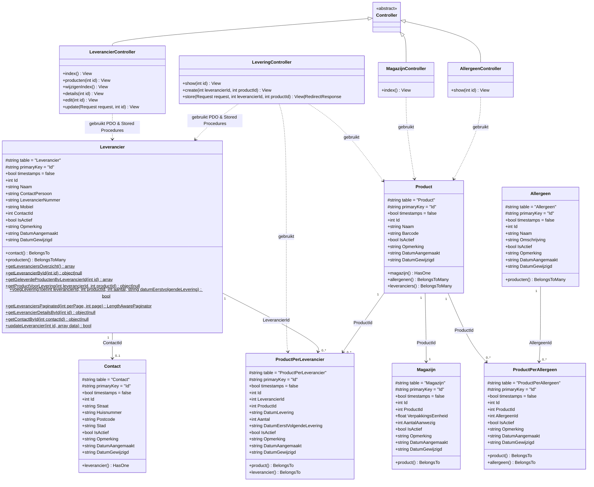

# Class-Diagram — Jamin Manager (BE-opdracht 03)

Dit class-diagram is gebaseerd op de daadwerkelijke classes in de applicatie voor het beheren en wijzigen van leveranciers en gerelateerde entiteiten.

---

## Toelichting per Class

| Class | Namespace | Verantwoordelijkheid |
| --- | --- | --- |
| `LeverancierController` | `App\Http\Controllers` | Verwerkt HTTP-requests voor het leveranciersoverzicht, gepagineerd wijzigingsoverzicht (`wijzigenIndex`), leverancierdetails (`details`), wijzigingsformulier (`edit`) en opslaan van wijzigingen (`update`). |
| `Leverancier` | `App\Models` | Bevat de Eloquent-relaties naar `Contact` en `Product` én alle statische PDO-methodes die communiceren met de MySQL Stored Procedures (`sp_CountLeveranciers`, `sp_GetLeveranciersPaginated`, `sp_GetLeverancierDetailsById`, `sp_GetContactById`, `sp_UpdateLeverancier`). |
| `Contact` | `App\Models` | Model voor de tabel `Contact` met adresgegevens (`Straat`, `Huisnummer`, `Postcode`, `Stad`) gekoppeld aan `Leverancier`. |
| `Product`, `Magazijn`, `Allergeen`, `ProductPerAllergeen`, `ProductPerLeverancier` | `App\Models` | Modellen voor producten, voorraad, allergenen en leveringen per leverancier. |
